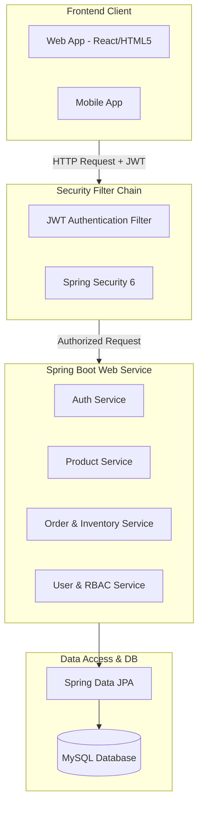
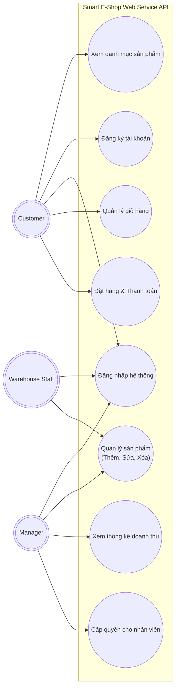
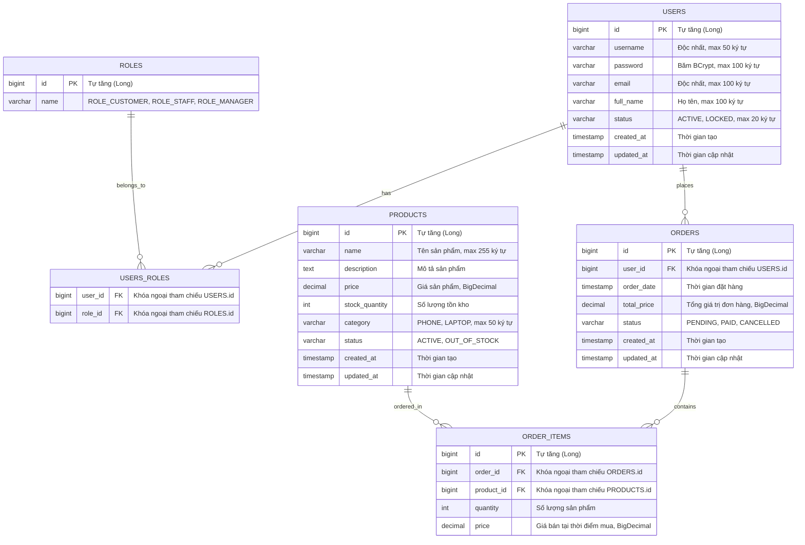

# SOFTWARE REQUIREMENTS SPECIFICATION (SRS)
**Dự án:** Hệ thống Bán lẻ Thiết bị Điện tử "Smart E-Shop (Shop AI)"  
**Khách hàng:** Công ty Bán lẻ thiết bị điện tử "TechNova"  
**Mã dự án:** PRJ-TECHNOVA-SHOPAI  
**Trạng thái:** Hoàn thiện (Phiên bản 1.0)  
**Tác giả:** Đỗ Án Thực Hành (System Analyst & Full-stack Developer)  
**Ngôn ngữ lập trình dự kiến:** Java (Spring Boot 3.x, Hibernate/JPA)  

---

## 1. Introduction (Giới thiệu)

### 1.1. Purpose (Mục đích)
Tài liệu Đặc tả Yêu cầu Phần mềm (SRS) này xác định chi tiết các yêu cầu chức năng (FR) và phi chức năng (NFR) cho hệ thống **Smart E-Shop (Shop AI)** của Công ty TechNova. Tài liệu này đóng vai trò là cơ sở để đội ngũ phát triển xây dựng hệ thống Backend API bằng Spring Boot và kiểm thử phần mềm.

### 1.2. Scope (Phạm vi dự án)
Dự án Smart E-Shop nhằm số hóa quy trình quản lý bán hàng của TechNova từ sổ sách/Excel lên nền tảng Web Service hiện đại. Hệ thống bao gồm:
*   **Phân hệ dành cho Khách hàng:** Đăng ký, đăng nhập, tìm kiếm/xem sản phẩm (điện thoại, laptop), giỏ hàng và đặt hàng trực tuyến.
*   **Phân hệ dành cho Quản trị (Admin Panel):**
    *   *Nhân viên kho (Warehouse Staff):* Quản lý thông tin sản phẩm (thêm, sửa, xóa sản phẩm).
    *   *Quản lý (Manager):* Xem thống kê báo cáo doanh thu, cấp quyền (Role assignment) cho nhân viên kho và quản lý khác.
*   **Lớp bảo mật:** Phân quyền nghiêm ngặt theo vai trò (RBAC) sử dụng JWT, ngăn chặn khách hàng truy cập trái phép vào trang quản trị.

### 1.3. Definitions, Acronyms, and Abbreviations (Định nghĩa & Thuật ngữ)
*   **SRS:** Software Requirements Specification (Đặc tả yêu cầu phần mềm).
*   **RBAC:** Role-Based Access Control (Kiểm soát truy cập dựa trên vai trò).
*   **JWT:** JSON Web Token (Token xác thực phi trạng thái).
*   **JPA/Hibernate:** Java Persistence API / Công cụ ORM tương tác cơ sở dữ liệu.
*   **API:** Application Programming Interface (Giao diện lập trình ứng dụng).
*   **N+1 Query:** Lỗi truy vấn lặp đi lặp lại trong ORM gây suy giảm hiệu năng nghiêm trọng.

---

## 2. Overall Description (Mô tả tổng quan)

### 2.1. Product Perspective (Bối cảnh hệ thống)
Hệ thống Smart E-Shop là một ứng dụng Web Service độc lập, gồm tầng Backend API viết bằng Spring Boot kết nối CSDL MySQL và cung cấp RESTful API cho ứng dụng Frontend (React/Angular hoặc Mobile App) tiêu thụ.

### 2.2. User Classes and Characteristics (Các tác nhân hệ thống)
Hệ thống định nghĩa 3 nhóm người dùng (Actors) chính:
1.  **Customer (Khách hàng):** Khách mua hàng trực tuyến. Cần đăng ký/đăng nhập để mua hàng. Có quyền xem sản phẩm mà không cần đăng nhập.
2.  **Warehouse Staff (Nhân viên kho):** Nhân viên Admin cấp thấp. Có quyền thêm, sửa, xóa sản phẩm trong kho. Tuyệt đối không có quyền xem thống kê tài chính hay gán vai trò.
3.  **Manager (Quản lý):** Người quản trị tối cao của TechNova. Có quyền xem báo cáo doanh thu, phân bổ vai trò cho nhân viên và có đầy đủ quyền quản trị sản phẩm của nhân viên kho.

### 2.3. Constraints (Các ràng buộc)
*   Hệ thống phải tuân thủ chuẩn RESTful API.
*   Bảo mật tài khoản: Mật khẩu khách hàng và nhân viên phải được băm bằng thuật toán BCrypt trước khi lưu vào cơ sở dữ liệu.
*   Hiệu năng: API phải phản hồi nhanh, cơ sở dữ liệu MySQL cần thiết kế tối ưu tránh lỗi khóa bảng hoặc quá tải kết nối.

---

## 3. Specific Requirements (Yêu cầu cụ thể)

### 3.1. Functional Requirements (Yêu cầu chức năng)

#### 3.1.1. Sơ đồ Use Case tổng quan (Use Case Diagram)
Sơ đồ dưới đây phân định rõ ranh giới hệ thống và các mối quan hệ tương tác của 3 tác nhân:

#### 3.1.2. Bảng User Stories & Acceptance Criteria (Agile User Stories)

| Mã ID | Vai trò (As a) | Hành động (I want to) | Lợi ích (So that) | Tiêu chí chấp nhận (Acceptance Criteria) |
| :--- | :--- | :--- | :--- | :--- |
| **US-AUTH-01** | Khách hàng mới | Đăng ký tài khoản bằng Username, Email, Mật khẩu và Tên. | Có tài khoản để tiến hành đặt hàng trực tuyến trên hệ thống. | 1. Username và Email phải là độc nhất trong hệ thống. 2. Mật khẩu phải có độ dài tối thiểu 6 ký tự. 3. Hệ thống tự động gán vai trò mặc định là `ROLE_CUSTOMER`. |
| **US-AUTH-02** | Người dùng | Đăng nhập bằng tài khoản và mật khẩu đã đăng ký. | Nhận mã JWT Token để thực hiện các yêu cầu cần xác thực. | 1. Trả về mã lỗi 401 JSON nếu sai tài khoản/mật khẩu. 2. Trả về JWT Token và thời gian hết hạn dưới dạng JSON nếu thông tin chính xác. |
| **US-PROD-01** | Mọi khách hàng | Xem danh sách và chi tiết các sản phẩm (điện thoại, laptop). | Lựa chọn sản phẩm mong muốn trước khi quyết định mua hàng. | 1. API `GET /api/v1/public/products` không yêu cầu JWT Token. 2. Cho phép lọc theo danh mục (Phone/Laptop) và hỗ trợ phân trang dữ liệu. |
| **US-ORDER-01**| Khách hàng | Gửi yêu cầu đặt hàng chứa danh sách các sản phẩm và số lượng tương ứng. | Mua sản phẩm và tiến hành thanh toán hóa đơn. | 1. Khách hàng phải đăng nhập (gửi kèm JWT). 2. Hệ thống kiểm tra số lượng tồn kho của từng sản phẩm. Nếu không đủ, hủy giao dịch và báo lỗi. 3. Trừ số lượng tồn kho tương ứng và lưu đơn hàng ở trạng thái `PAID`. |
| **US-ADMIN-01**| Nhân viên kho | Thêm sản phẩm mới, cập nhật thông tin sản phẩm và xóa sản phẩm. | Cập nhật kho hàng thực tế của TechNova lên hệ thống. | 1. Yêu cầu xác thực JWT với vai trò `ROLE_STAFF` hoặc `ROLE_MANAGER`. Trả về 403 nếu là `ROLE_CUSTOMER`. 2. Data Validation: Tên sản phẩm không trống, giá tiền phải lớn hơn 0, số lượng tồn kho >= 0. |
| **US-ADMIN-02**| Quản lý | Xem tổng hợp doanh thu bán hàng theo thời gian thực. | Đánh giá tình hình kinh doanh của cửa hàng TechNova. | 1. Yêu cầu xác thực JWT với vai trò `ROLE_MANAGER`. Trả về 403 đối với các vai trò khác. 2. Dữ liệu doanh thu trả về định dạng JSON gồm tổng số tiền đã thanh toán từ các đơn hàng thành công. |
| **US-ADMIN-03**| Quản lý | Thay đổi hoặc bổ sung vai trò (Role) cho tài khoản người dùng khác. | Cấp quyền hoạt động cho nhân viên kho mới hoặc quản lý mới. | 1. Yêu cầu xác thực JWT với vai trò `ROLE_MANAGER`. Trả về 403 đối với các vai trò khác. 2. Cập nhật bảng liên kết `users_roles` trong database ngay lập tức. |

---

### 3.2. Data Requirements & ERD (Yêu cầu dữ liệu & Sơ đồ ERD)

Để đáp ứng tối đa hiệu năng và tính toàn vẹn dữ liệu cho hàng chục ngàn lượt truy cập, cơ sở dữ liệu được thiết kế chuẩn hóa và áp dụng các khóa ngoại chặt chẽ.

---

### 3.3. Non-Functional Requirements (Yêu cầu phi chức năng)

#### 3.3.1. Security & Authentication (Bảo mật & Xác thực)
*   **Xác thực không trạng thái (Stateless):** Toàn bộ API yêu cầu bảo mật (trừ các endpoint public) bắt buộc phải kiểm tra chữ ký số của JWT gửi lên qua header `Authorization: Bearer <token>`.
*   **Phân quyền (RBAC):** Ứng dụng phân quyền chặt chẽ thông qua Filter Security.
*   **Mật khẩu an toàn:** Bắt buộc băm mật khẩu bằng thuật toán **BCrypt** độ mạnh (strength) 10.
*   **Phòng chống rò rỉ thông tin lỗi:** Tắt chế độ debug và stacktrace mặc định của Spring Security đối với môi trường production, xử lý Exception tập trung để trả về định dạng JSON thống nhất cho client.

#### 3.3.2. Performance & Scalability (Hiệu năng & Khả năng chịu tải)
*   **Xử lý N+1 Query:** Tất cả các liên kết trong Entity Model JPA (như `@OneToMany`, `@ManyToMany`, `@ManyToOne`) bắt buộc sử dụng cơ chế `FetchType.LAZY` để tránh việc Hibernate tự động thực hiện các câu query JOIN không cần thiết.
*   Khi cần tải các thông tin liên kết (ví dụ: hiển thị danh sách hóa đơn kèm chi tiết sản phẩm), lập trình viên bắt buộc phải sử dụng `@EntityGraph` hoặc `JOIN FETCH` trong Repository để giảm số lượng câu truy vấn xuống còn 1 câu duy nhất.
*   **Database Connection Pooling:** Sử dụng HikariCP làm connection pool mặc định, thiết lập kích thước pool phù hợp (ví dụ: `maximum-pool-size = 50`) để phục vụ hàng chục ngàn người truy cập đồng thời mà không bị ngắt kết nối CSDL.
*   **Data Validation:** Việc xác thực dữ liệu đầu vào được thực hiện ở tầng Web (Controller) bằng Spring Validation để ngăn chặn các dữ liệu rác, không hợp lệ gửi xuống tầng Database.
